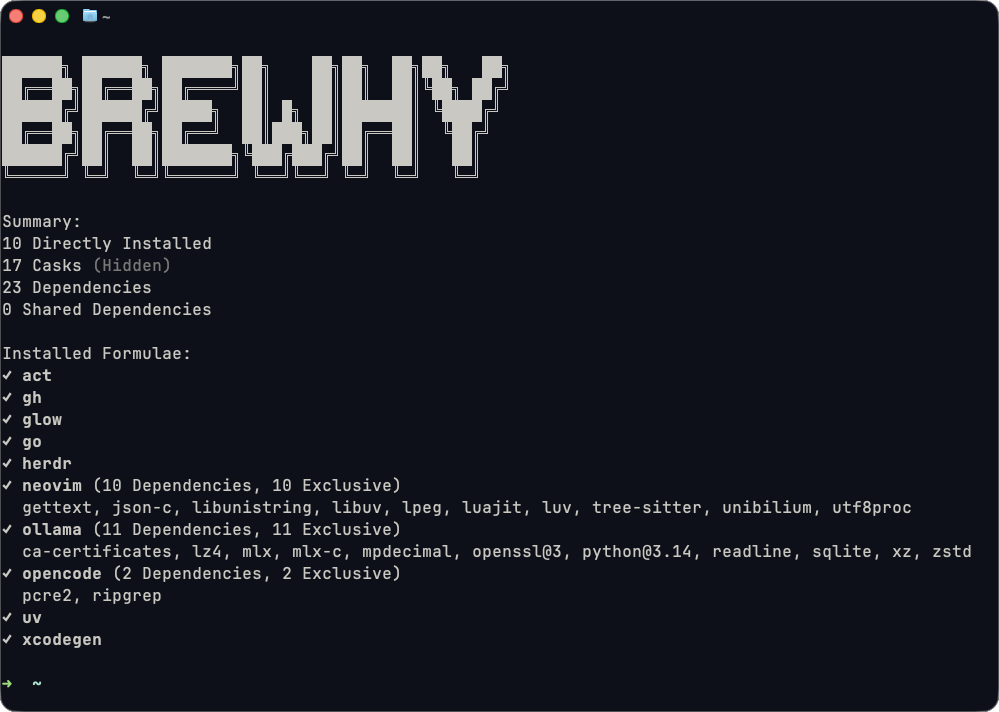

# Brewhy

A read-only CLI that explains why each formula is installed.

## Why?

See which formulae you installed yourself and which dependencies each one brought in.

## Preview



## Installation

### Requirements

- `macOS` with `Homebrew` — [requirements](https://docs.brew.sh/Installation#macos-requirements).
- `Node.js 22.22.2+ (22.x)` or `24.15+`, with `npm`.

### Quick Start

Run this command in your terminal to download and build the latest published release.

```bash
curl -fsSL https://raw.githubusercontent.com/wereallcode/brewhy/master/scripts/install.sh | bash
```

Open a new terminal and run `brewhy` for an overview; use `brewhy --help` or `brewhy --version` for details.

_If `brewhy` is not found, follow the installer's instructions to add `$HOME/.local/bin` to your shell's `PATH`._

#### Update

Run the installation command again to update to the latest release.

#### Uninstall

To uninstall the release installation, run:

```bash
curl -fsSL https://raw.githubusercontent.com/wereallcode/brewhy/master/scripts/install.sh | bash -s -- --uninstall
```

This removes Brewhy's installed files and command link; Homebrew packages and shell configuration are preserved.

## Guides

- [Manual Installation](docs/guides/Manual-Installation.md)
- [Troubleshooting](docs/guides/Troubleshooting.md)
